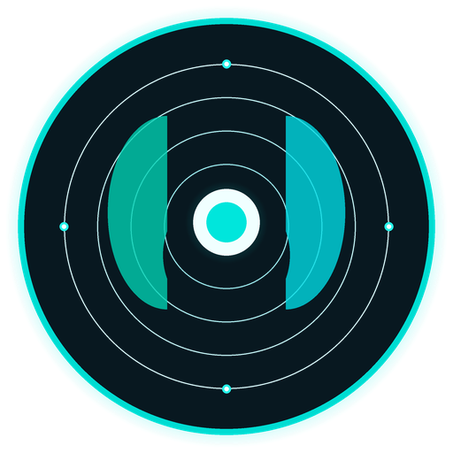
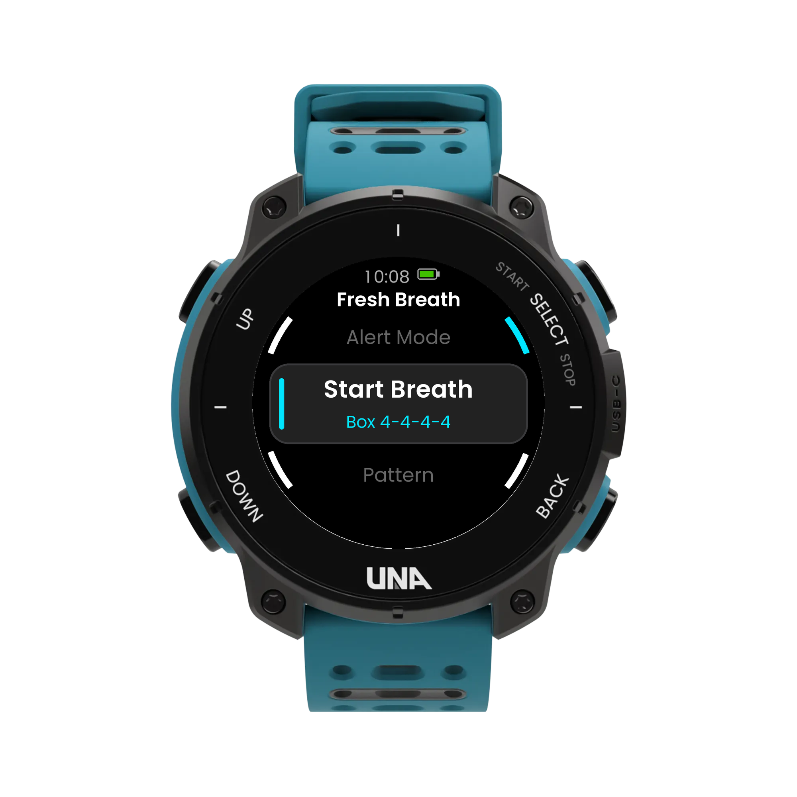
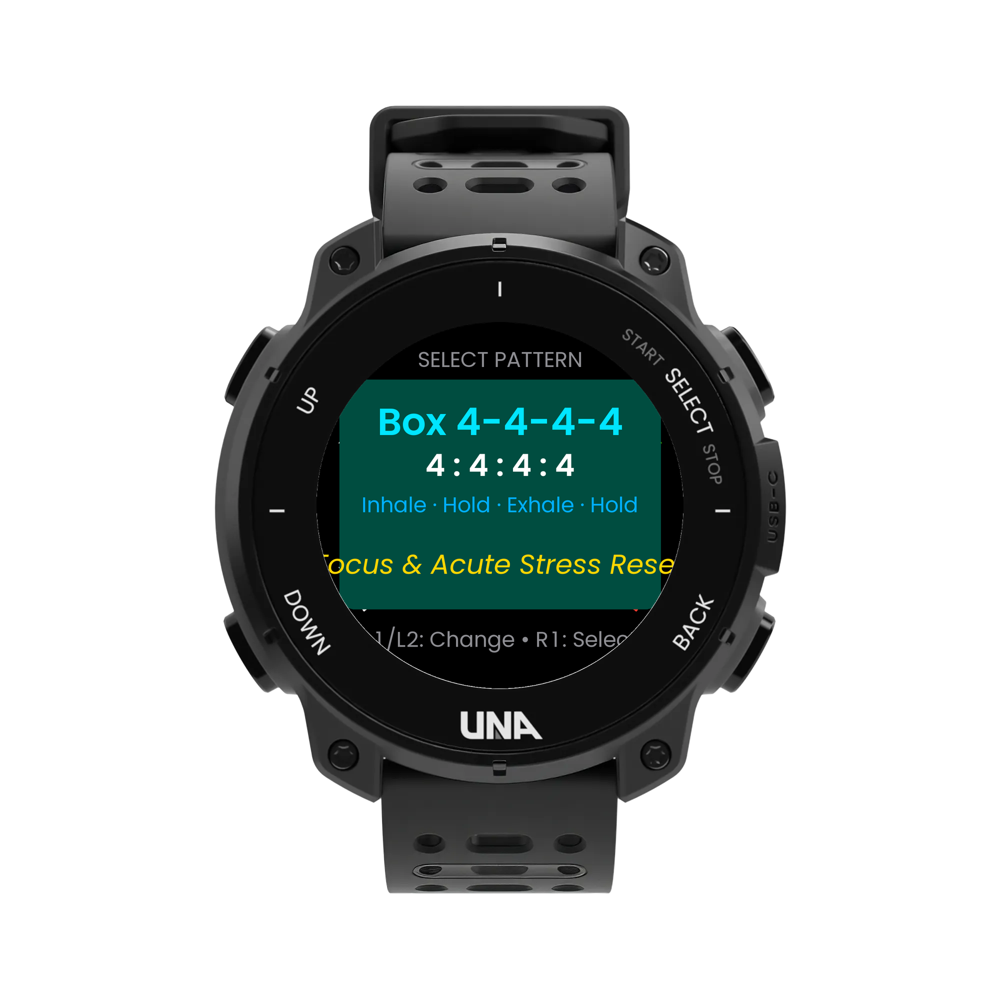
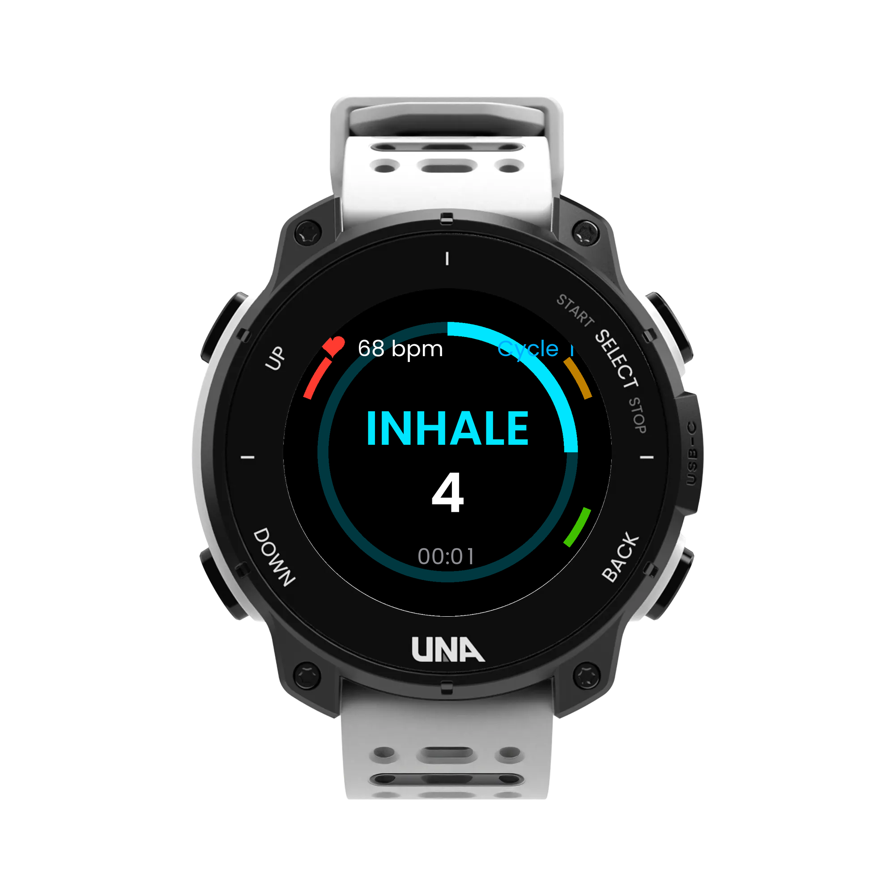
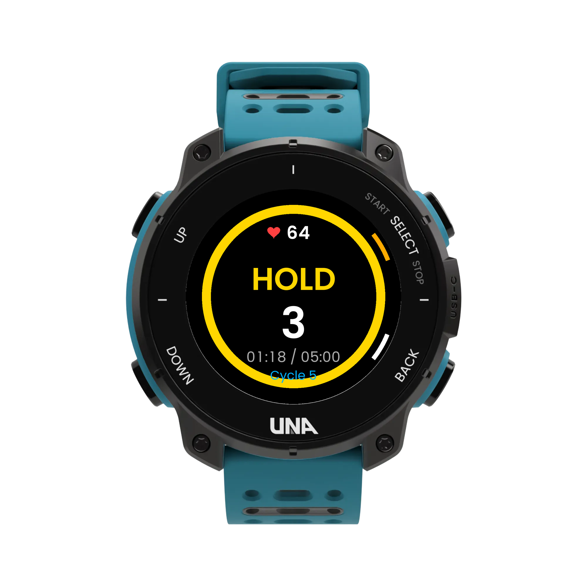
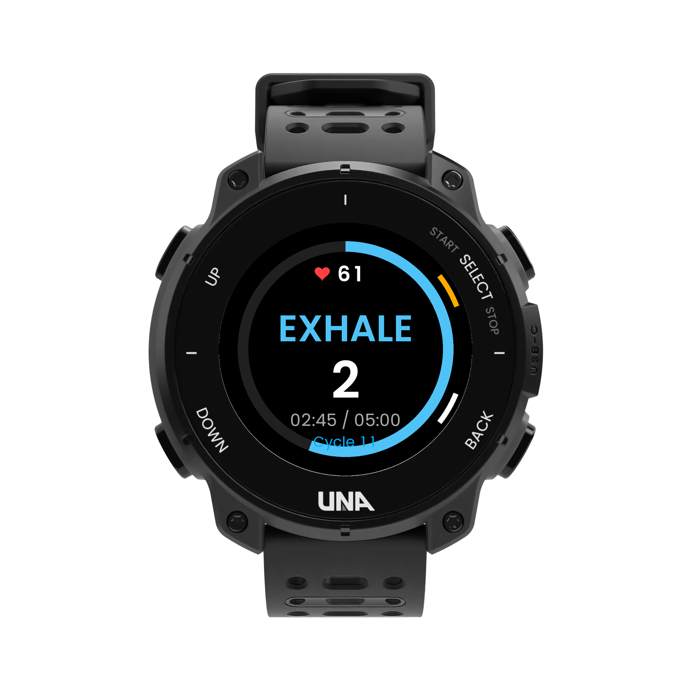
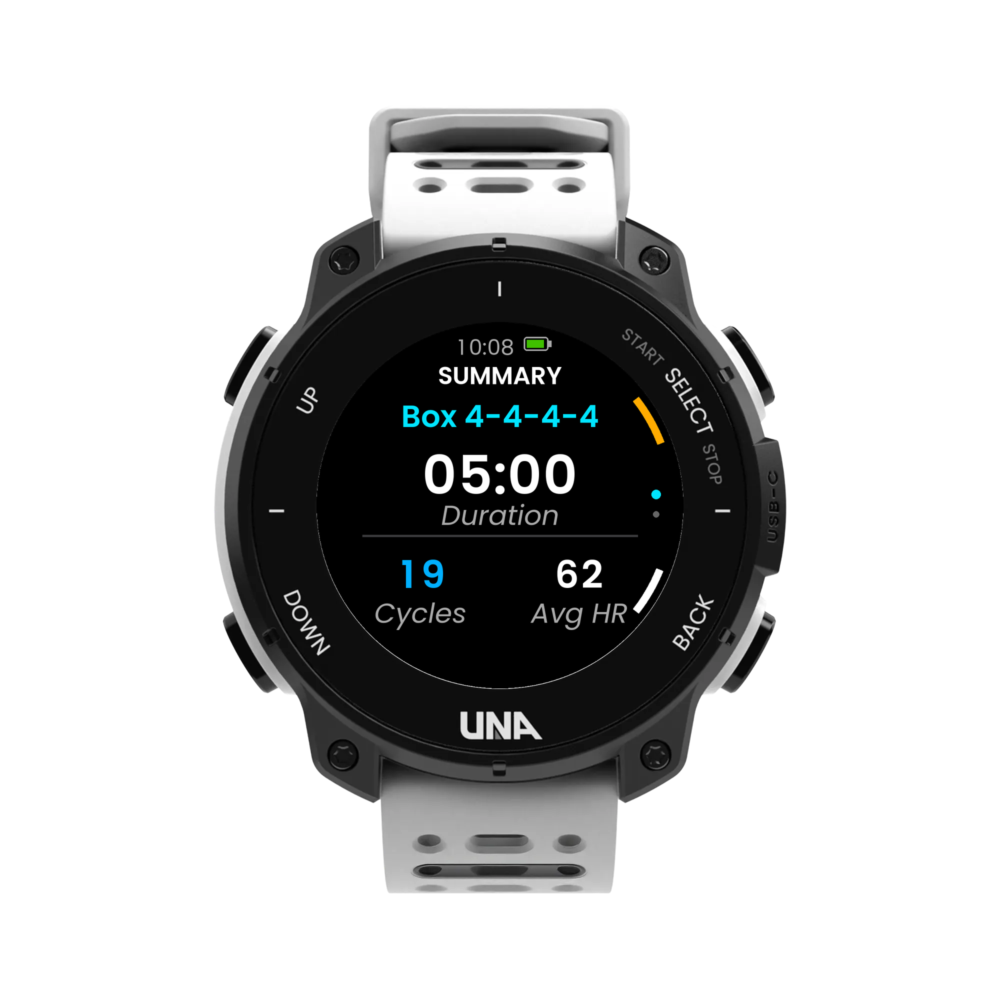

# FreshBreath 🌿

<p align="center">
  <br/>
  <b>Mindful Breathing & Meditation Activity for UNA Watch</b><br/>
  <code>App ID: 432197B5C95258BF</code> • <code>Version: v1.0.0</code> • <code>Type: Activity</code>
</p>

---

## 📸 Device Screenshots

Official UNA Watch photorealistic mockups rendered across **Teal**, **Black**, and **White** case finishes:

| Main Screen (Teal Watch) | Pattern Selection (Black Watch) | Inhale Phase (White Watch) |
| :---: | :---: | :---: |
|  |  |  |
| *Session setup & target duration* | *Box Breathing (4:4:4:4 Method)* | *Active expanding guide (68 bpm)* |

| Hold Phase (Teal Watch) | Exhale Phase (Black Watch) | Workout Summary (White Watch) |
| :---: | :---: | :---: |
|  |  |  |
| *Yellow retention circle ring* | *Contracting sky-blue guide* | *FIT workout saved with metrics* |

---

## 🫁 Researched Breathwork Methods & Recommended Durations

FreshBreath includes 6 scientifically validated breathwork protocols:

| Method | Ratio (In : Hold : Out : Hold) | Recommended Session Time | Physiological Mechanisms & Benefits |
| :--- | :---: | :---: | :--- |
| **Box Breathing** *(4:4:4:4 Method)* | **4s : 4s : 4s : 4s** | **5 – 15 min** *(or 3 min acute reset)* | Equalizes CO₂ and O₂ levels. Developed by Navy SEALs (Mark Divine) and rooted in yogic *Sama Vritti* with *Kumbhaka*. Rapidly blunts acute sympathetic adrenaline spikes, clears mental fog, and restores autonomic balance under pressure. |
| **4-7-8 Relax** *(Weil Method)* | **4s : 7s : 8s : 0s** | **3 – 5 min** *(4 to 8 full cycles)* | Developed by Dr. Andrew Weil. Extended exhalation and retention intensely stimulate the parasympathetic vagal brake via acetylcholine release, reducing resting heart rate and facilitating sleep onset and anxiety relief. |
| **Resonance / Coherent** *(5:5 Method)* | **5s : 0s : 5s : 0s** | **10 – 20 min** *(daily practice)* | Paces breathing at ~6 breaths per minute (~0.1 Hz). Synchronizes respiration, cardiovascular baroreflex rhythms, and Heart Rate Variability (HRV), maximizing autonomic flexibility and long-term cardiovascular resilience. |
| **Deep Calm** *(4:8 Method)* | **4s : 0s : 8s : 0s** | **5 – 10 min** | 1:2 inspiratory-to-expiratory ratio maximizes Respiratory Sinus Arrhythmia (RSA), promoting pronounced heart-rate deceleration on each exhalation. Ideal for panic recovery and hyperarousal down-regulation. |
| **Energize & Awake** *(4:1:2 Method)* | **4s : 1s : 2s : 0s** | **3 – 5 min** | Lengthened inhalation with rapid exhalation gently increases sympathetic alertness and alertness neurotransmitters without triggering chronic stress. Ideal for morning wakefulness and combating midday lethargy. |
| **Equal Flow** *(4:4 Method)* | **4s : 0s : 4s : 0s** | **5 – 10 min** | Gentle, continuous rhythmic flow without retention pauses. Serves as an approachable daily mindfulness anchor for beginners. |

---

## ⚡ Key Features

1. **Native Activity Lifecycle (`APP_TYPE "Activity"`)**
   - Implemented using UNA SDK's dual-process architecture: `FreshBreathService.elf` (background sensory/data engine) and `FreshBreathGUI.elf` (LVGL hardware-accelerated GUI).
2. **Visual Pacer & Animation**
   - 240x240 circular bezel arc that smoothly expands clockwise in glowing cyan during **Inhale**, remains steady in yellow during **Hold**, contracts in sky blue during **Exhale**, and displays a real-time countdown timer.
3. **Eyes-Closed Haptic Feedback**
   - Utilizes `RequestVibroPlay` to pulse at every phase transition (gentle double click on inhale, soft tick on hold, smooth buzz on exhale, and alert on workout completion). Users can meditate with eyes closed without staring at the screen.
4. **Workout Saving & Activity Naming**
   - Sessions are finalized as a FIT workout (`fit::Sport::Training`, `fit::File::Activity`).
   - The FIT `Workout` message embeds the pattern title in `kWktNameNum` (e.g. `Breathwork - 4:4:4:4 Method`).
   - Standard and developer fields save duration, cycle count, average HR, minimum HR, maximum HR, and metabolic calories.
   - A companion JSON sidecar (`activity_YYYYMMDDTHHMMSS.json`) is saved alongside the FIT file:
     ```json
     {
       "time_start": 1730214420,
       "duration": 300,
       "hr_avg": 62.4,
       "hr_max": 74.0,
       "hr_min": 56.0,
       "calories": 14.5,
       "activity_type": "workout",
       "activity_name": "Breathwork - 4:4:4:4 Method",
       "title": "Breathwork - 4:4:4:4 Method",
       "sport": "training",
       "pattern": "Box 4-4-4-4",
       "cycles": 18
     }
     ```
   - On-watch `Activity/summary.json` is preserved so the user can review their last workout statistics anytime.

---

## 🎮 Watch Button Controls

The watch uses the 4 hardware bezel buttons:

| Button | Key | Main Screen | Pattern / Duration Select | Active Breathing Session | Summary Screen |
| :---: | :---: | :--- | :--- | :--- | :--- |
| **L1** *(Top Left)* | `'1'` | Review Last Summary / Exit | Previous Option | Discard Session | Finish & Return |
| **L2** *(Bottom Left)* | `'2'` | Open Pattern Selector | Next Option | — | — |
| **R1** *(Top Right)* | `'3'` | **Start Breathing** | **Confirm Selection** | **Pause / Resume** | **Finish & Return** |
| **R2** *(Bottom Right)* | `'4'` | Open Duration Selector | Cancel / Back | **Finish & Save Workout** | — |

---

## 📁 Project Structure

```
FreshBreath/
├── assets/
│   ├── mockups/                       # Official Penpot UNA Watch device templates
│   ├── previews/                      # Standalone 240x240 circular UI screens
│   └── screenshots/                   # Device renders (Teal, Black, White)
├── Output/
│   └── FreshBreath_1.0.0.uapp         # Packaged watch executable (v1.0.0, ID: 432197B5C95258BF)
├── Resources/
│   ├── icon_512x512.png               # High-res store/marketing icon
│   ├── icon_60x60.png                 # Main 60x60 launcher menu icon
│   └── icon_30x30.png                 # Small 30x30 list/tray icon
├── scripts/
│   ├── generate_icons.py              # Icon generation utility
│   └── generate_screenshots.py        # Screen renderer & device mockup compositor
└── Software/
    ├── Libs/
    │   ├── Header/
    │   │   ├── ActivitySummary.hpp
    │   │   ├── ActivitySummarySerializer.hpp
    │   │   ├── ActivityWriter.hpp
    │   │   ├── BreathPatterns.hpp
    │   │   ├── Commands.hpp
    │   │   ├── Service.hpp
    │   │   ├── Settings.hpp
    │   │   ├── SettingsSerializer.hpp
    │   │   └── Track.hpp
    │   ├── Sources/
    │   │   ├── ActivitySummarySerializer.cpp
    │   │   ├── ActivityWriter.cpp
    │   │   ├── BreathPatterns.cpp
    │   │   ├── Service.cpp
    │   │   └── SettingsSerializer.cpp
    │   └── libs.cmake
    └── Apps/
        ├── FreshBreath-CMake/
        │   └── CMakeLists.txt         # App CMake build configuration
        └── LVGL-GUI/
            ├── assets/                # Poppins fonts and UI icons
            ├── gui/
            │   ├── include/gui/
            │   │   ├── Assets.hpp
            │   │   ├── model/         # Model & ModelListener
            │   │   ├── screens/       # Main, Pattern, Duration, Breath, Summary
            │   │   └── theme/         # 64-color palette helpers
            │   └── src/
            │       ├── GuiApp.cpp     # Entry hook
            │       ├── model/
            │       ├── screens/
            │       └── theme/
            └── lvgl-gui.cmake
```

---

## 🛠️ Building the Application

Ensure the **UNA SDK** is installed and the ST ARM GCC toolchain is on your `PATH`.

```bash
# 1. Set the UNA_SDK environment variable
export UNA_SDK="/path/to/una-sdk"

# 2. Configure build with CMake
cd Software/Apps/FreshBreath-CMake
cmake -B build -G "Unix Makefiles"

# 3. Compile and package the .uapp container
cmake --build build -j8
```

The compiled binary package will be produced at:
`Output/FreshBreath_1.0.0.uapp`
